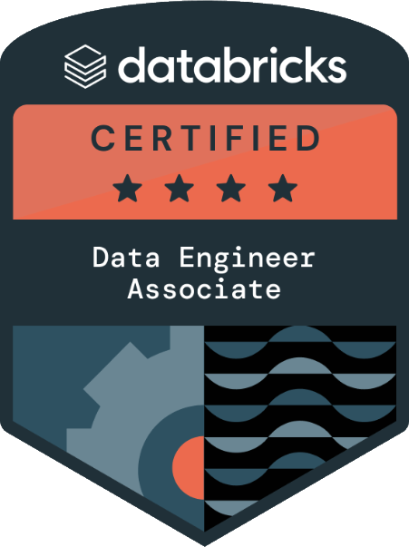

## Tomas Sarmir: Data & Analytics Engineer

## 🏅 Certifications

<table>
<tr>
<td valign="top">

### Microsoft

| Certification | Badge |
|---|:---:|
| **PL-300** Power BI Data Analyst Associate <a href="https://learn.microsoft.com/api/credentials/share/en-us/16726426/3C7837151A63051B?sharingId=E99D790FAA2B4C88">View Certificate</a> |  |
| **DP-600** Fabric Analytics Engineer Associate <a href="https://learn.microsoft.com/api/credentials/share/en-us/16726426/C12ECC0ABDCE839B?sharingId=E99D790FAA2B4C88">View Certificate</a> |  |
| **DP-700** Fabric Data Engineer Associate <a href="https://learn.microsoft.com/api/credentials/share/en-us/16726426/C58A0CC6F37BAAFE?sharingId=E99D790FAA2B4C88">View Certificate</a> |  |

</td>
<td valign="top">

### Databricks

| Certification | Badge |
|---|:---:|
| **Data Engineer** Associate <a href="https://credentials.databricks.com/672ffb53-591d-41b5-aa5e-3bd20b7af576">View Certificate</a> |  |

</td>
</tr>
</table>

### Platforms & Tools

**Languages**
- SQL
- DAX
- Python
- PySpark

**Data Engineering / Analytics Concepts**
- Data Modeling (Star Schema, Dimensional Modeling)
- ETL / ELT Pipelines
- Data Warehousing
- Business Intelligence Reporting

